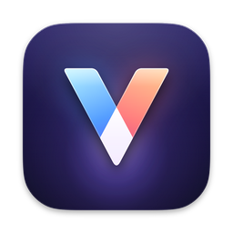
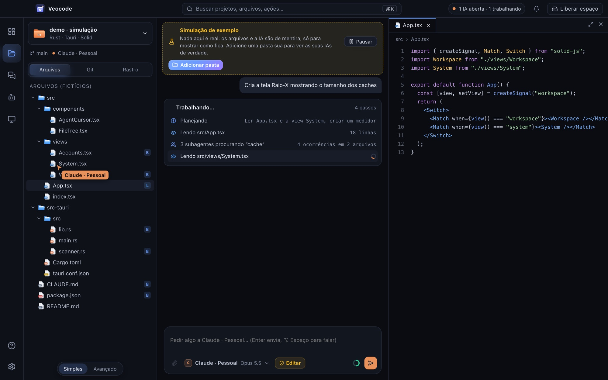
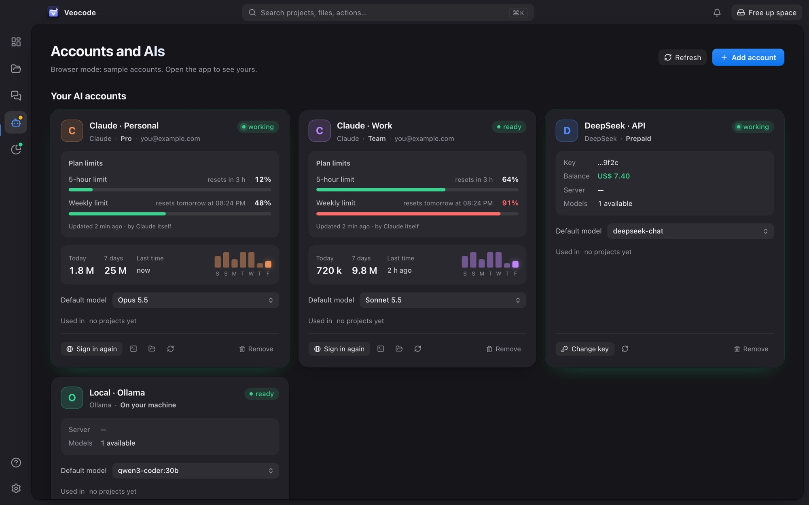
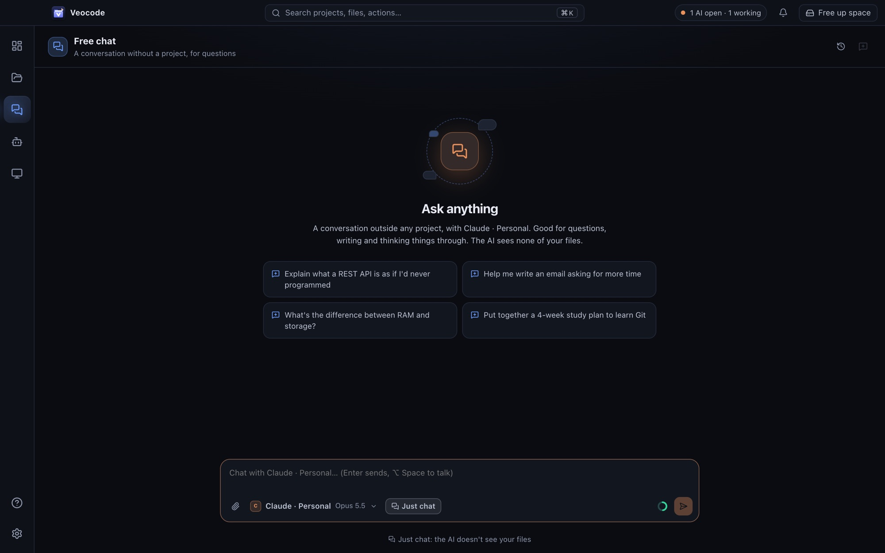
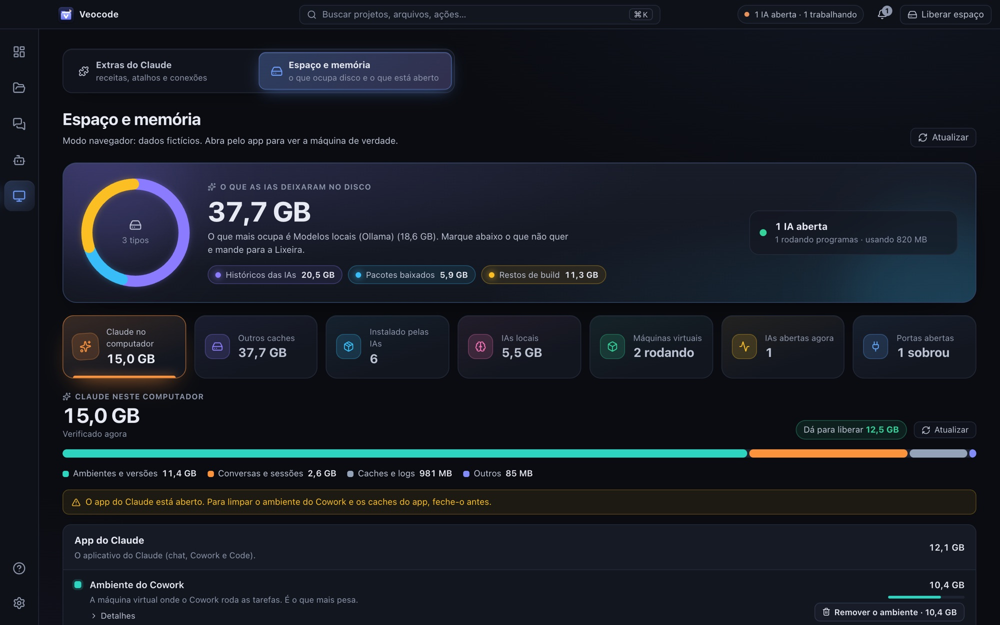
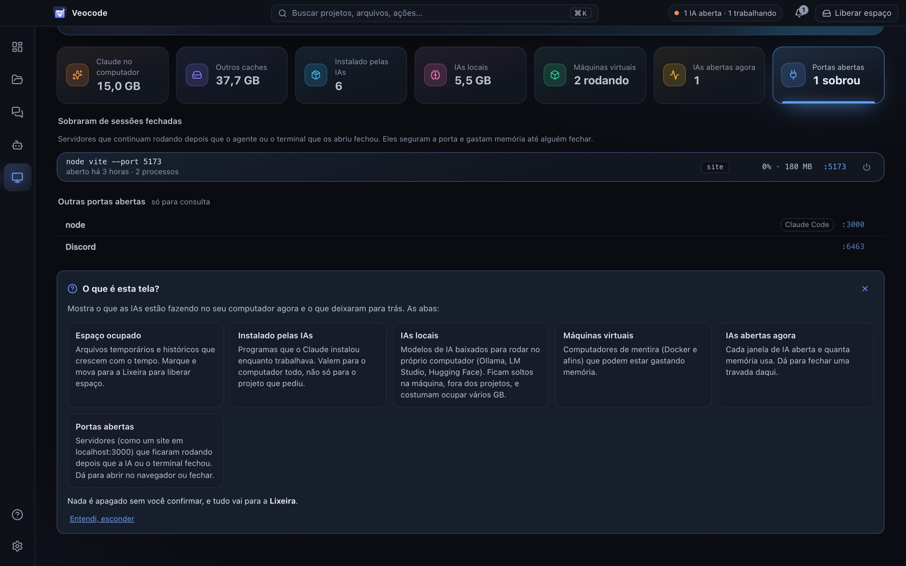
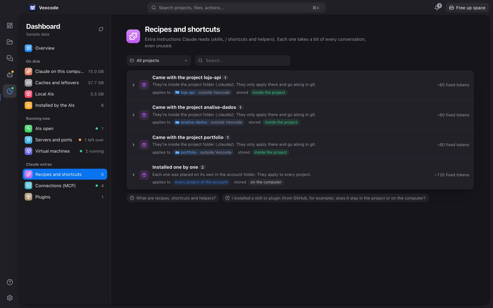
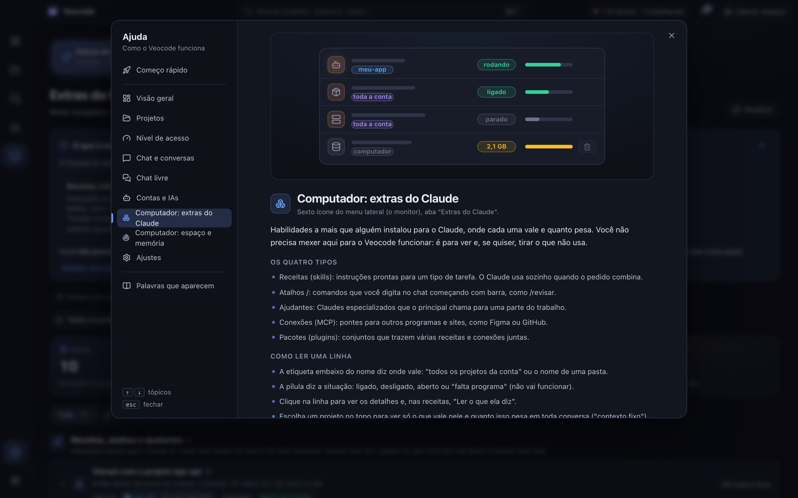
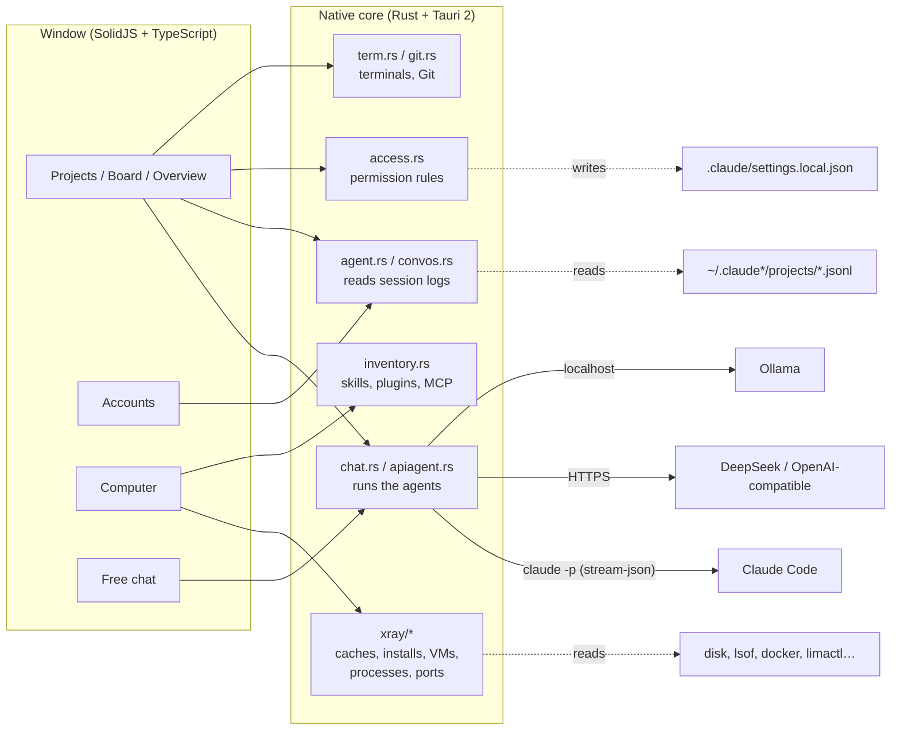

<p align="center">
  
</p>

<h1 align="center">Veocode</h1>

<p align="center">
  <b>See and control what your AI coding agents are doing on your Mac.</b><br>
  One window for every project, every AI account and everything the agents leave behind.
</p>

<p align="center">
  
  
  
  
  
</p>

<p align="center">
  <a href="https://witchmymac.com/veocode/"><b>witchmymac.com/veocode</b></a> ·
  <a href="#install">Install</a> ·
  <a href="#the-problem">The problem</a> ·
  <a href="#screens">Screens</a> ·
  <a href="#how-it-works">How it works</a> ·
  <a href="#build-from-source">Build from source</a>
</p>

<p align="center">
  
</p>

> [!NOTE]
> Available in **English** and **Brazilian Portuguese**. It follows your Mac's language; change it any time in **Settings → Language**. Everything runs on your Mac: no account, no server, no telemetry.

## Install

Open **Terminal** and paste:

```bash
curl -fsSL https://witchmymac.com/install.sh | bash -s veocode
```

The [witchmymac installer](https://witchmymac.com/install.sh) downloads the latest `.dmg` from this repository's [Releases](https://github.com/matthfaria96/Veocode/releases), checks its SHA-256 against the one GitHub publishes, copies **Veocode.app** to `/Applications` and opens it. Works on Apple Silicon and Intel, macOS 13 or later.

Prefer to do it by hand? Download the `.dmg` from [Releases](https://github.com/matthfaria96/Veocode/releases/latest), drag Veocode to Applications and, the first time, run `xattr -cr /Applications/Veocode.app` (the app is signed with the witchmymac certificate, not an Apple Developer ID).

**What you need:** at least one AI to talk to. Veocode works with [Claude Code](https://docs.claude.com/en/docs/claude-code) (your Claude Pro/Max/Team login), DeepSeek and any OpenAI-compatible API (with your key), and local models through [Ollama](https://ollama.com).

## The problem

AI coding agents are great, and they are also a black box running with your user's permissions:

- You open Claude Code in three terminals, two editors and the desktop app, and lose track of **which one is working on what**, which one is waiting for your approval, and which account each is using.
- Agents **install things globally** (`brew`, `npm -g`, `pip`), download models, start Docker containers and leave dev servers running on `localhost:3000` long after the session closed.
- Their caches, session logs and sandboxes quietly grow to **tens of gigabytes**.
- Skills, plugins and MCP servers pile up per account and per project, each one costing context tokens in every conversation, and nobody remembers what is installed where.
- Permission rules live in hidden JSON files, so "what is this agent allowed to do in this folder?" has no easy answer.

**Veocode is the dashboard for all of that.** It does not replace your agent or your editor: it sits next to them, reads what they write to disk and shows it, and gives you safe buttons to clean up.

## Screens

### Projects
A real folder per project, in two modes you switch with one click (⌘E). **Code** works like an editor: file tree, files in tabs, a Git panel where clicking a changed file shows what it was and what it is now side by side, and a terminal at the bottom or on the right (⌘J). **AI** works like Claude: your projects on the left, each one opening its conversations newest first (fork any conversation to try another path, and the branch shows up under the original), and a debug panel on the right: the folder's app running in a browser (desktop or phone size), the servers and commands running in the folder, each subagent and what it's doing, and the activity log. The agent's chat runs inside the app (Claude Code headless with `claude -p`, or DeepSeek / OpenAI-compatible / Ollama with a small set of file tools). Every step the agent takes — reading, searching, editing, running a command — is animated on the tree with a cursor in the account's color, so you *see* the work instead of scrolling logs. Permission requests show up as cards with **Allow** / **Deny**.

Run several conversations in the same project at once (a busy one keeps working while you open another), and turn on **focus mode** to see them all side by side, each with its own message box. The grid adjusts itself to 2, 3, 4, 6 or 8 conversations. Click the context chip in the message box (next to Memory) to see what fills Claude's context window (messages, tools, MCP, skills, memory files) and compact the conversation in one click.


### Accounts and AIs
Several Claude accounts side by side (each one is its own `CLAUDE_CONFIG_DIR`), with the 5-hour and weekly plan limits, daily usage and default model. DeepSeek shows balance and models; Ollama shows what is installed locally. API keys go to the macOS Keychain.



### Free chat
A conversation outside any project, with any of your accounts. In **Só conversa** (just talk) the AI sees no files; in **Olhar o computador** (look at my computer) it can list, read and search your home folder to answer — never edit, delete or run commands — and credential folders (`.ssh`, `.aws`, Keychain, `.env` files…) stay blocked.



### Computer → Space and memory
Everything the AIs left on this Mac, measured: Claude's own data (sessions, sandboxes, versions), package-manager and build caches, what Claude Code installed (read from its session history), local models (Ollama, LM Studio, Hugging Face), virtual machines and containers (Docker, Lima, UTM, Parallels, VirtualBox) with the project that created them, and the agents running right now with every process they started.



**Open ports** lists every program listening on localhost and spots **leftover dev servers**: a `vite`, `next dev` or `python -m http.server` still holding a port after the agent or terminal that started it is gone. Open it in the browser or stop it (and its child processes) with one click.



### Computer → Claude extras
Every skill, slash command, subagent, plugin and MCP server, for every account and project: where it applies (one folder, the whole account), whether it is on or running, how much CPU/RAM/disk it uses and **how many tokens it adds to every conversation**. Turn things off or remove them; removals go through `claude plugin …` / `claude mcp remove` or to the Trash.



### Built-in help
Press <kbd>F1</kbd> anywhere: one illustrated page per screen, plus a glossary of the terms agents use.



Other screens: **Overview**, the start screen (today's work across projects in numbers, every project's live chat in a grid that adjusts itself to how many you have (drag to reorder), and folders where you already used Claude), and **Settings** (light/dark theme, icon and animation styles). <kbd>⌘K</kbd> opens the command palette, <kbd>⌘1</kbd>–<kbd>⌘5</kbd> switch screens.

## How it works



- **It reads, it doesn't hook.** Veocode follows the JSONL session logs Claude Code already writes under each account's `projects/` folder. Nothing is injected into Claude Code, and agents opened in your own terminal or editor show up too.
- **Access levels are real.** Picking a level for a project (Read only, Suggest, Edit, Full) is translated into Claude Code permission rules in `.claude/settings.local.json` — only Veocode's own rules, with the previous content kept so it can be undone exactly — and passed with `--permission-mode` / `--settings` to the chats it runs. For API models, Veocode itself enforces the same rules on every tool call.
- **Cleaning is reversible.** Caches, skills and leftovers go to the macOS **Trash**, never `rm`. Package removals are shown as commands for you to run. Stopping a process is only allowed for processes started by an agent, or leftover servers in your own folders, never system apps.
- **Secrets stay secret.** MCP configs are shown with the *names* of environment variables, never their values. API keys live in the Keychain.

## Build from source

Requirements: macOS 13+, Node 20+, Rust (stable) and Xcode Command Line Tools (for the Swift dictation helper).

```bash
git clone https://github.com/matthfaria96/Veocode.git
cd Veocode
npm install
npm run tauri dev          # the native app, with hot reload
```

```bash
npm run dev                # UI only, in the browser at http://localhost:1420 (sample data, no disk access)
```

```bash
cd src-tauri && cargo test # Rust tests
```

```bash
rustup target add x86_64-apple-darwin
npx tauri build --target universal-apple-darwin --bundles app   # universal Veocode.app
```

### Project layout

| Path | What lives there |
|---|---|
| `src/views/` | One file per screen (`Workspace`, `Board`, `Accounts`, `System`, `Inventory`, `Livre`, `Settings`) |
| `src/components/` | Shared UI: chat panel, file tree, editor, Git panel, terminal, dialogs |
| `src/*.ts` | Client-side stores (one per area: `chat`, `accounts`, `xray`, `board`…) |
| `src/i18n.ts`, `src/i18n/en.ts` | Translations: the Portuguese text is the key, `en.ts` holds the English. `tx("…")` in the UI, `tr`/`trf!` in Rust |
| `src/help/` | Help texts (`topics.ts`) and their animated SVG scenes (`Scenes.tsx`) |
| `src-tauri/src/` | Rust commands: agents, session logs, access rules, accounts, terminals, Git |
| `src-tauri/src/xray/` | Machine scanners: caches, installs, VMs/containers, processes and ports, local models |
| `src-tauri/voice/` | Swift helper for on-device dictation (Apple Speech) |
| `docs/` | Screenshots and the original development notes (Portuguese) |

## FAQ

**Does it send my code anywhere?** Only to the AI you choose to chat with, exactly like using that AI directly. Veocode itself has no server and no analytics.

**Does it change my Claude Code setup?** It reads your accounts' folders. The only files it writes are the permission rules for a project when you set an access level, and its own data in `~/Library/Application Support/com.veocode.app` (chats, terminal history, settings).

**Can I switch the language?** Yes: **Settings → Language** (System, Português or English). The AI answers in the language you write in.

**Windows / Linux?** The Rust side compiles for Windows, but only macOS is tested and released.

## License

[MIT](LICENSE) · Made by [Matheus Faria](https://github.com/matthfaria96) · Part of [witchmymac](https://witchmymac.com)
